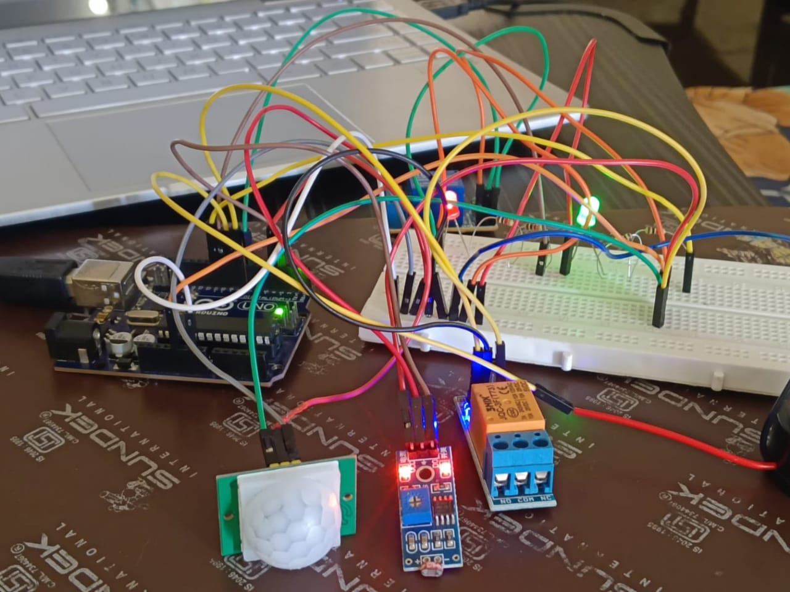
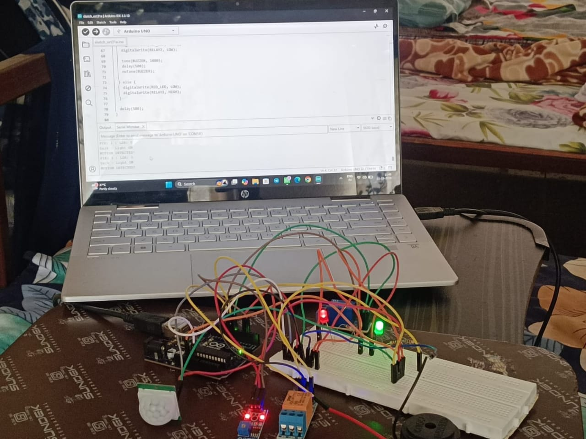
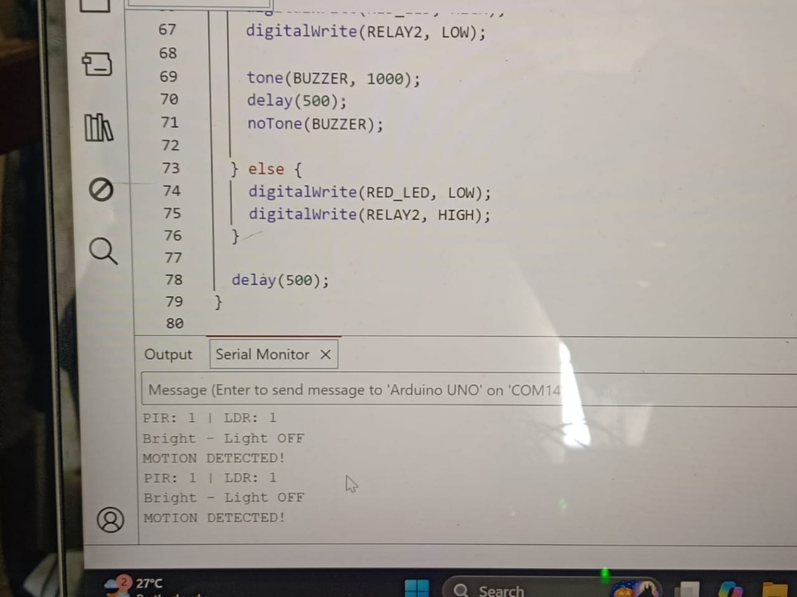

# Smart Home Automation and Security System

An Arduino Uno-based hardware project that combines motion detection and light sensing for automatic lighting control and basic security alerts.

## Features
- Motion detection using PIR sensor.
- Ambient light detection using LDR sensor.
- Automatic lighting control using relay modules.
- LED and buzzer indications for security alerts.

## Components Used
- Arduino Uno
- PIR Motion Sensor
- LDR Sensor
- Relay Modules
- Buzzer
- Red and Green LEDs
- Breadboard
- Jumper Wires

## Working Principle

The PIR sensor detects human movement, while the LDR senses ambient light levels. Arduino Uno processes the sensor inputs and controls the relay modules, LEDs and buzzer according to the programmed conditions.

## Programming Tools
- Arduino IDE
- Embedded C / Arduino C++

## Project Status
Completed and tested as a hardware prototype.
## Project Demonstration

### Hardware Setup

### Hardware Implementation

### Serial Monitor Output

